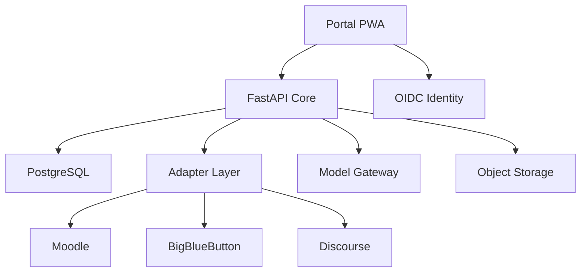

# Architecture Blueprint

Version: 0.2.0-draft | Proposed architecture | Not implemented or verified

## Scope
Learners, facilitators, experts and organizations share a portal for courses, articles, media, community, live workshops, practice, competitions and competency development.
## Logical architecture

## Decisions
- Core owns navigation, catalog, enrollment orchestration and competency evidence. Engines own native execution records.
- MVP uses modular monolith and background worker; no mandatory microservices.
- Next.js, FastAPI, PostgreSQL, Keycloak and S3-compatible storage are proposed baseline. Moodle, BBB and Discourse are integrated incrementally; H5P for interactive content. Open edX is an alternative, not concurrent requirement.
- Optional adapters: Strapi, Wiki.js, PeerTube, Castopod, Onyx, Temporal, Metabase.
## Deployment
Local Docker Compose first; separate media workloads; cloud deployment only after capacity and connectivity tests. No fixed sizing until measured.
## Gates
G1 identity and catalog; G2 learning journey; G3 workshop and evidence; G4 community and challenges; G5 AI evaluation. Each requires reproducible tests and rollback instructions.
