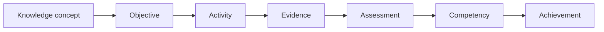

# Ontology & Taxonomy

**Document ID:** ARC-03  
**Document revision:** 0.2-draft  
**Review status:** Proposed  
**Owner role:** Architecture lead (assignment pending)  
**Dependencies:** [Architecture index](README.md) and [documentation standard](../../governance/documentation-standard.md).

Version: 0.2.0-draft | Target architecture proposed | Local prototype evidence appended; target not fully implemented or verified

## Semantic model

## Vocabulary
| Scheme | Initial terms |
|---|---|
| Resource type | article, document, video, podcast, course, template |
| Activity type | lesson, exercise, workshop, project, challenge |
| Level | foundation, intermediate, advanced |
| Role | learner, facilitator, assessor, moderator, administrator |
| Subject | management, improvement, quality, leadership |
## Governance
Stable URI per concept; SKOS prefLabel per language, altLabel for synonyms, broader/narrower for hierarchy, related for associative links. OWL class relations are separate from taxonomy. Deprecate rather than reuse IDs. Proposed concept changes require review.
## Acceptance
No hierarchy cycles, duplicate preferred labels within a scheme and locale, or dangling references. Map competencies to learning objectives and evidence.

## Phase 1–2 evidence update — 2026-11-25

### Local semantic subset
The extracted sample catalog contains three courses, four resources and six competencies. Course/resource competency labels connect learning to evidence views. Stable semantic URIs, SKOS/OWL serializations, ontology validation and controlled vocabulary governance are still proposed; label-based associations are not a semantic conformance proof.

[Implementation package and decision reconciliation](implementation/phase-1-2/README.md) · [Acceptance evidence](implementation/phase-1-2/ACCEPTANCE.md).
