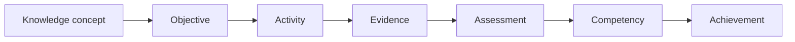

# Ontology & Taxonomy

Version: 0.2.0-draft | Proposed architecture | Not implemented or verified

## Semantic model

## Vocabulary
| Scheme | Initial terms |
|---|---|
| Resource type | article, document, video, podcast, course, template |
| Activity type | lesson, exercise, workshop, project, challenge |
| Level | foundation, intermediate, advanced |
| Role | learner, facilitator, assessor, moderator, administrator |
| Subject | management, improvement, quality, leadership |
## Governance
Stable URI per concept; SKOS prefLabel per language, altLabel for synonyms, broader/narrower for hierarchy, related for associative links. OWL class relations are separate from taxonomy. Deprecate rather than reuse IDs. Proposed concept changes require review.
## Acceptance
No hierarchy cycles, duplicate preferred labels within a scheme and locale, or dangling references. Map competencies to learning objectives and evidence.
