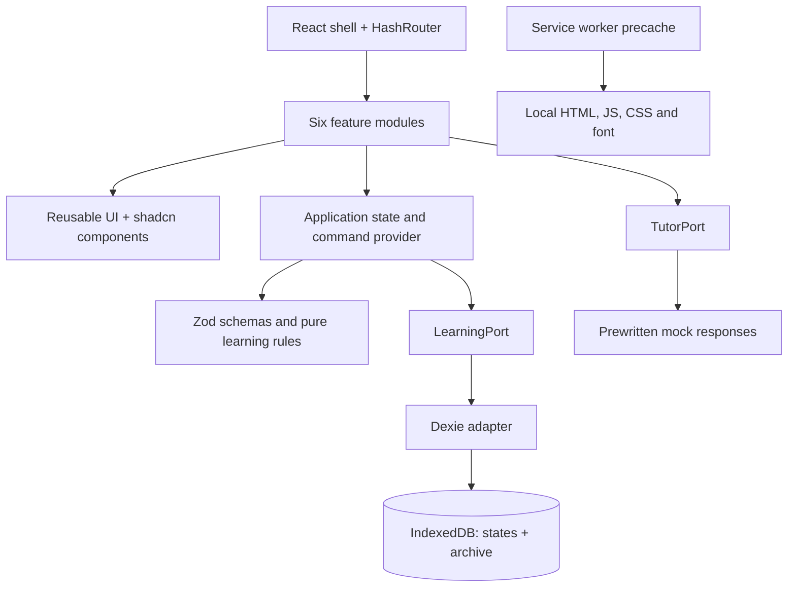

# NIKWAY Learning OS — Phase 1–2 implementation evidence

**ثبت نتایج توسعه در بستهٔ معماری v0.2.0-draft — 2026-11-25**

نتیجهٔ فازهای ۱ و ۲ نمونهٔ محلی: **PASS**. تحقق کل معماری هدف ۱۲ سند: **PARTIAL**. این دو وضعیت نباید یکسان تفسیر شوند.

## تفکیک شماره‌گذاری مأموریت و نقشهٔ راه

«فاز ۱ و ۲» در این بسته به مأموریت محلیِ بازآرایی معماری و ارتقای فناوری اشاره دارد. این شماره‌ها با Phase 01 و 02 در نقشهٔ راه سازمانی (benchmark و PRD) یکسان نیستند و هیچ gate آن نقشهٔ راه را قبول‌شده اعلام نمی‌کنند. فایل‌های benchmark و roadmap که هم‌زمان به PR افزوده شده‌اند حفظ می‌شوند.

## اسناد و شواهد

- [معماری پیاده‌سازی‌شده](ARCHITECTURE.md)
- [گزارش پذیرش و حدود اعتبار](ACCEPTANCE.md)
- [تغییرات و رفع نقص](CHANGELOG.md)
- [Build موفق](evidence/build.log)
- [۲۴ آزمون Vitest موفق](evidence/unit-green.log)
- [۱۲ آزمون Playwright موفق](evidence/e2e.log)
- [قابلیت حمل و آفلاین در زیرپوشه](evidence/portability.json)
- [بررسی وابستگی‌ها](evidence/npm-audit.json) و [نسخه‌های نصب‌شده](evidence/dependencies.txt)
- [manifest کد آزموده‌شده](evidence/source-sha256.json)، [lockfile](evidence/package-lock.json) و [منشأ/هش شواهد](evidence/provenance.json)

این‌ها خروجی اجرای محلیِ قبلاً انجام‌شده در همین مأموریت‌اند؛ آزمون GitHub Actions یا نتیجهٔ CI روی commit این مخزن نیستند. این ثبت شامل مستندات و شواهد است، نه سورس نرم‌افزار یا استقرار آن. سورس و Build در خروجی محلی `nikway-learning-os-v2.zip` تحویل شده‌اند؛ hash بسته در provenance ثبت شده است. اجرای مستقل آزمون‌ها نیازمند همان بستهٔ نرم‌افزار است. لینک localhost فقط روی رایانهٔ میزبان کار می‌کند و لینک انتشار عمومی نیست.

## تطبیق تصمیم‌های معماری

| موضوع | هدف v0.2 پیشنهادی | وضعیت واقعی فاز ۱–۲ | تصمیم باقیمانده |
|---|---|---|---|
| Frontend | Next.js | React + TypeScript + Vite مطابق مأموریت اجرا | انتخاب Next.js برای هدف آینده هنوز نیازمند ADR؛ این نمونه آن را رد یا تأیید نمی‌کند |
| Backend | FastAPI | وجود ندارد | قرارداد API، auth و persistence سرور |
| Storage | PostgreSQL و object storage | Dexie/IndexedDB + migration محلی | tenancy، sync و مدیریت conflict |
| Identity | Keycloak/OIDC | پروفایل صرفاً نمایشی؛ بدون login | مجوزدهی و هویت واقعی |
| AI | Model gateway و agent roles | TutorPort + MockTutor؛ بدون inference | انتخاب adapter، retrieval و ارزیابی ایمنی |
| UI | Tailwind/shadcn، فونت پیشنهادی | Tailwind/shadcn، Noto موجود، RTL/LTR | ممیزی دسترس‌پذیری کامل |
| Learning engines | Moodle/BBB/Discourse/LRS | متصل نشده | آزمون نسخه، مجوز و قرارداد |
| Offline | draft queue و server sync پیشنهادی | precache دارایی‌ها و دادهٔ محلی | sync سرور هنوز وجود ندارد |
| Standards | ماتریس استانداردها | شواهد محدود عملکرد و UI | همه وضعیت‌های ارزیابی استاندارد همچنان Not assessed |

## معماری واقعیِ نمونه



## قرارداد و قواعد داده

```ts
type LearningState = {
  version: 2;
  done: [number, number, number]; // bounded by 8, 10, 6 lessons
  saved: number[];               // resource IDs 0..3
  sim: number;                   // nonnegative integer
  attemptIds: string[];
};

type LearningAction =
  | { type: 'complete'; courseId: number; lessonIndex: number }
  | { type: 'bookmark'; resourceId: number }
  | { type: 'attempt'; attemptId: string; choice: number }
  | { type: 'reset' };
```

- تکمیل درس بعدی مجاز است؛ تکرار همان درس count را افزایش نمی‌دهد و جهش به درس آینده رد می‌شود.
- هر تلاش شبیه‌سازی یک شناسه دارد؛ تکرار شناسه تعداد تلاش را افزایش نمی‌دهد.
- تغییر وضعیت در transaction ثبت می‌شود و شکست نوشتن نباید به‌عنوان موفقیت نمایش داده شود.
- دادهٔ قدیمی معتبر یک‌بار مهاجرت می‌کند؛ دادهٔ خراب باعث reset خودکار نمی‌شود.
- import/reset نسخهٔ قبل را در archive نگه می‌دارند؛ دادهٔ خام قدیمی localStorage حفظ می‌شود.
- Chat و مرحلهٔ جاری آزمایش session-only هستند؛ پیشرفت، نشان‌ها و شمار تلاش‌ها ماندگارند.

```mermaid
sequenceDiagram
  participant UI as Application boot
  participant LS as Legacy localStorage
  participant DB as IndexedDB transaction
  UI->>DB: Read main state
  alt Valid state already exists
    DB-->>UI: Current validated v2 state
  else First initialization
    UI->>LS: Read nikway-demo-v1 (no deletion)
    LS-->>UI: Raw legacy data or absent
    UI->>UI: Zod validation
    alt Valid or absent
      UI->>DB: Commit state and legacy archive atomically
      DB-->>UI: Ready
    else Invalid or blocked storage
      UI-->>UI: Recovery error; preserve original
    end
  end
```

## پذیرش و باقی‌مانده‌ها

| دامنه | وضعیت | حدود |
|---|---|---|
| شش ماژول و مسیرهای کاربری | PASS | دادهٔ نمونه، Chromium |
| ماندگاری و migration | PASS | آزمون دادهٔ نمونه و مشاهدهٔ مرورگر روی origin قبلی؛ پروفایل‌های دیگر مستقل‌اند |
| آفلاین | PASS | بعد از اولین دریافت موفق؛ شامل reload |
| Responsive و RTL/LTR | PASS | ۳۲۰/۳۹۰ پیکسل و دسکتاپ؛ دستگاه فیزیکی/سایر موتورهای مرورگر آزمون نشده |
| کل معماری سازمانی و استانداردها | PARTIAL / Not assessed | جامعه، کارگاه، هویت، backend، AI واقعی و تعامل استانداردها باقی‌اند |

هیچ merge، deployment، فعال‌سازی خدمات خارجی یا تأیید استاندارد به‌واسطهٔ این ثبت انجام نمی‌شود. شاخهٔ معماری و PR در حالت Draft باقی می‌مانند.
